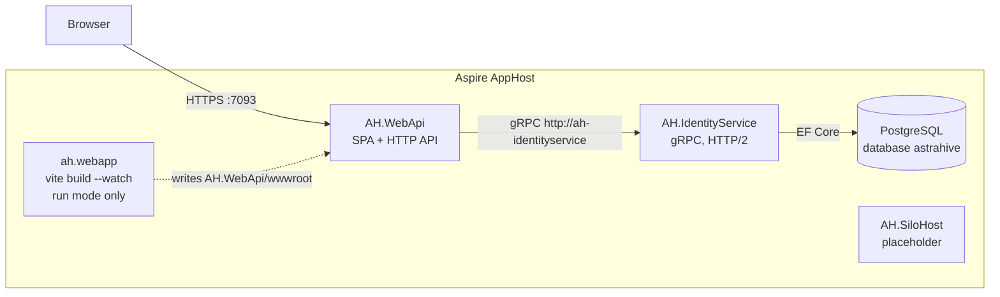
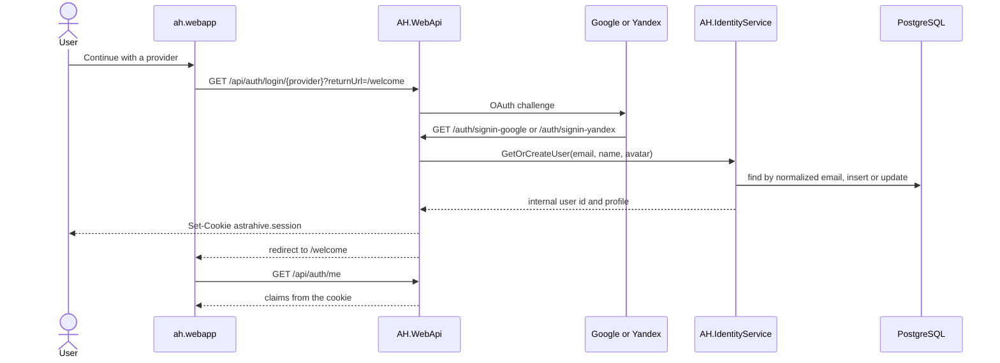
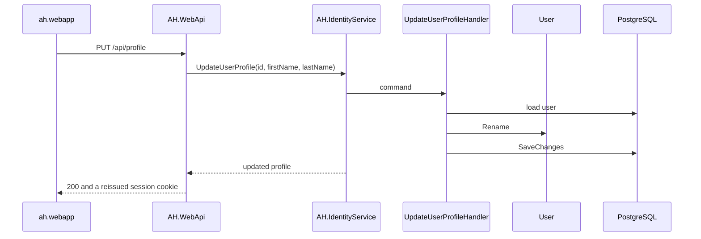
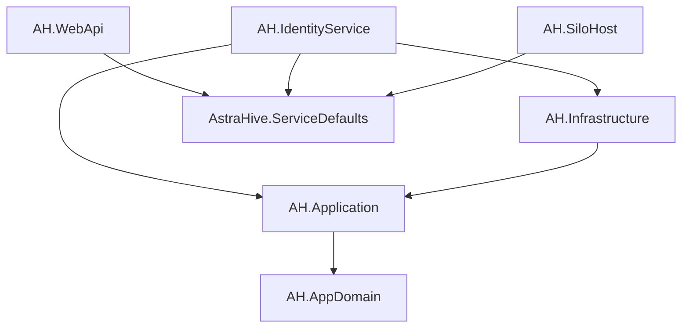
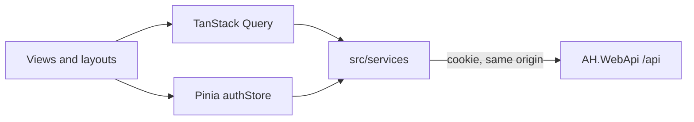
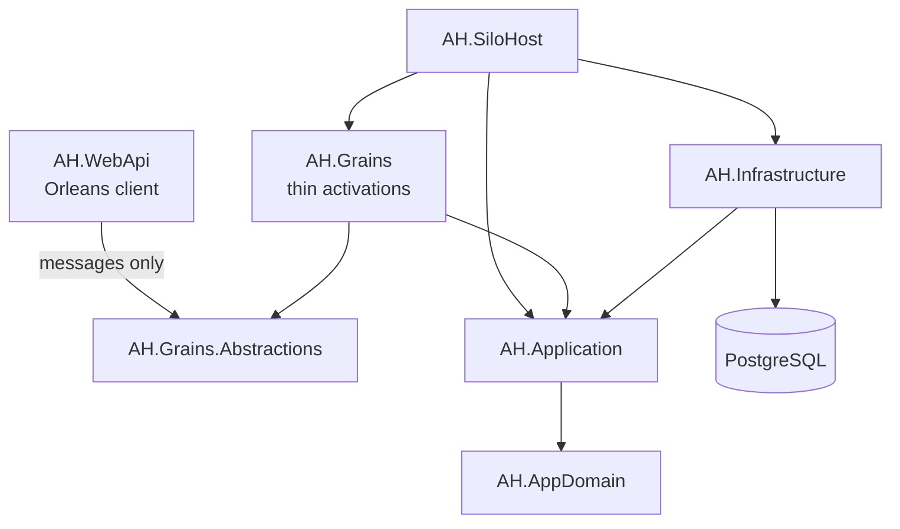

# Architecture

Astra Hive is a virtual machine orchestration system: operators connect to virtual machines over SSH, group them into clusters, and schedule recurring maintenance tasks. That orchestration is the target shape of the system. What runs today is the console and identity: a Vue application served by `AH.WebApi`, external sign-in, and a gRPC service that owns users in PostgreSQL.

.NET Aspire starts the processes and the database. Business rules stay in `AH.AppDomain` and `AH.Application`. Hosts only compose them.

## Runtime

The browser has one origin, `https://localhost:7093`. `AH.WebApi` serves the single-page application, `/api`, and the OAuth callbacks. It never opens the database. User reads and writes go to `AH.IdentityService` over gRPC, and that service is the only process that talks to PostgreSQL.

`ah-webapp` exists only while `aspire run` is in run mode. The watcher rebuilds the bundle into `AH.WebApi/wwwroot`; refresh the browser to see a change. A Release build of `AH.WebApi` runs `npm run build` itself, so a published host does not need a frontend container. `AH.SiloHost` is started, but it is still the stock template: no Orleans silo, no database, and nothing calls it.

PostgreSQL is the Aspire database resource `astrahive`, with a data volume so users survive a restart. `AH.IdentityService` applies EF Core migrations on startup in Development. Production migrations are applied explicitly.

## Sign-in

There are no local passwords and no JWTs. The session is the HttpOnly cookie `astrahive.session` (SameSite=Lax, 14-day sliding expiration). Google and Yandex are the only sign-in providers. Their client id and secret come from AppHost parameters, not from source.

On the OAuth callback, `AH.WebApi` calls `GetOrCreateUser` and stores the internal user id in `NameIdentifier`. Users are matched by email. A provider fills a first or last name only while that field is still empty (`User.SyncFromProvider`). A name the user saved later (`User.Rename`) is kept. The avatar has no editor, so it keeps syncing from the provider.

`GET /api/auth/me` reads the cookie. It does not call IdentityService. `POST /api/auth/logout` clears the cookie. A provider that fails sends the browser to `/login?error=...`.

## Profile

The profile page loads the user from the database, not from the cookie, so the screen shows the stored record.

`AH.WebApi` reissues `astrahive.session` after a successful rename because `/api/auth/me` serves the name from claims. If the cookie names a user the database no longer has, the API signs the session out and returns 401, and the console returns to the login page.

Expected failures travel as `Result<T>` from the handler, become gRPC status codes in `RpcUserService`, and become Problem Details (RFC 9457) in the API. Exceptions are for unexpected failures.

## Layers

Dependencies point inward. `AH.AppDomain` references nothing. `AH.Application` references only the domain (plus EF Core abstractions, so `IAppDbContext` can expose `DbSet<T>`). `AH.Infrastructure` implements those interfaces. Orleans types stay out of the domain and the application layer.

`AH.WebApi` does not reference `AH.Application` or `AH.Infrastructure`. Its only view of users is the linked protobuf `AH.IdentityService/Protos/user_service.proto`, compiled as a gRPC client. `GrpcChannel` cannot use Aspire's `https+http://` scheme, so the client address is `http://ah-identityservice`; service discovery still resolves the host.

A use case is a folder under `AH.Application`: a command or query, a plain handler class, a FluentValidation validator, and a response DTO. Handlers are registered in `AddApplication()` and injected where they are used. There is no mediator and no repository per entity. `IAppDbContext` is the data-access surface.

`User` is the only aggregate so far. It enforces email normalization, name length, and the rule that a later provider sign-in does not overwrite a stored name.

## Frontend

`ah.webapp` is Vue 3 (`<script setup>`, JavaScript), Vue Router, Pinia, vue-i18n, and Tailwind. Server data goes through TanStack Query composables and `src/services`. Pinia holds the session (`authStore`) and nothing else that belongs in the database.

`App.vue` chooses the signed-out or signed-in layout from `authStore.isAuthenticated`. The router waits for one `GET /api/auth/me` probe before it renders a protected route. Unknown `/api/*` paths return 404 instead of `index.html`.

## Orchestration, not built yet

Virtual machines, clusters, and scheduled tasks are meant to be Orleans grains: one single-threaded activation per entity, with the rules still living in the domain and in application handlers. Grain projects exist and are empty. `AH.SiloHost` does not host a silo, and `AH.WebApi` is not a client.

When this is built, a grain opens a scope per call and resolves the handler from it. A grain activation outlives a request, so it must not take a scoped `IAppDbContext` or handler in its constructor. Domain rows stay in PostgreSQL. Orleans storage is for transient grain state, not for the registry of machines. Development clustering is localhost with in-memory grain storage. Production clustering is not chosen.

`AH.WebApi` would reference `AH.Grains.Abstractions` only. It would not reference `AH.Grains`.

## Projects

| Project | Role today |
| --- | --- |
| `ah.webapp/` | Vue console. Built into `AH.WebApi/wwwroot`. |
| `AH.WebApi/` | Browser host: static files, cookie session, OAuth, controllers. gRPC client of IdentityService. |
| `AH.IdentityService/` | gRPC `UserServiceRpc`. Composition root for users. Applies migrations in Development. |
| `AH.AppDomain/` | `User` and its invariants. No NuGet dependencies. |
| `AH.Application/` | `GetOrCreateUser`, `GetUser`, `UpdateUserProfile`. |
| `AH.Infrastructure/` | `AppDbContext`, EF configurations, migrations. |
| `AH.Grains.Abstractions/` | Empty. Future grain interfaces and serializable messages. |
| `AH.Grains/` | Empty. Future thin grain implementations. |
| `AH.SiloHost/` | Empty host with health endpoints. Future Orleans silo. |
| `AstraHive.AppHost/` | Aspire: Postgres, the three hosts, and the frontend watcher in run mode. |
| `AstraHive.ServiceDefaults/` | OpenTelemetry, health checks, service discovery, HTTP resilience, Serilog. |
| `tests/AH.Application.Tests/` | Domain and handler tests against PostgreSQL in Testcontainers. |

Projects sit at the repository root. `/src/` and `/tests/` in `AstraHive.slnx` are solution folders only.

## Cross-cutting

Each host calls `AddServiceDefaults()`. Logs use Serilog in the host, with `ILogger<T>` everywhere else, and flow to the Aspire dashboard through OpenTelemetry. HTTP clients take the ServiceDefaults resilience pipeline. Service URLs and the database connection come from Aspire references.

Coding conventions for contributors are in [`AGENTS.md`](AGENTS.md).
