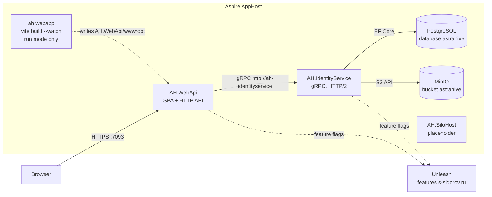
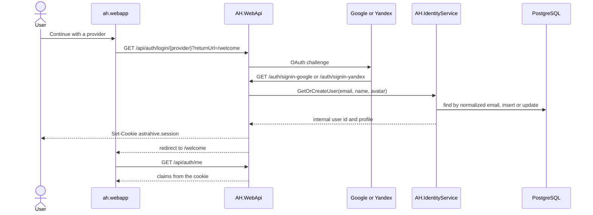
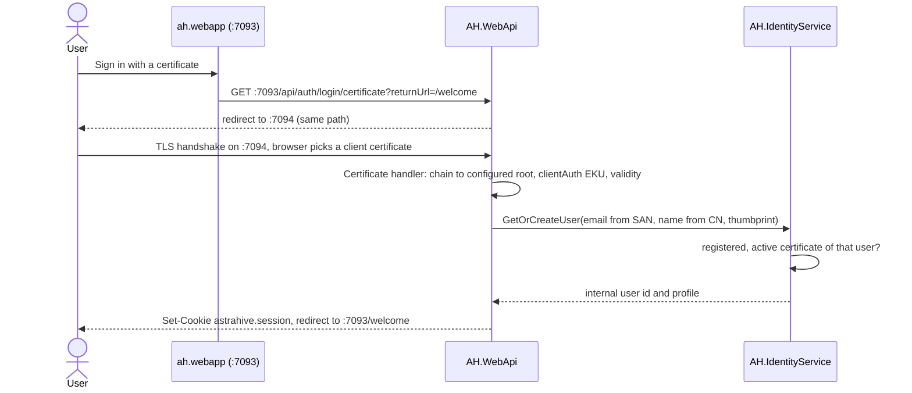
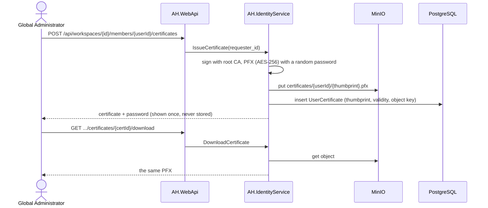
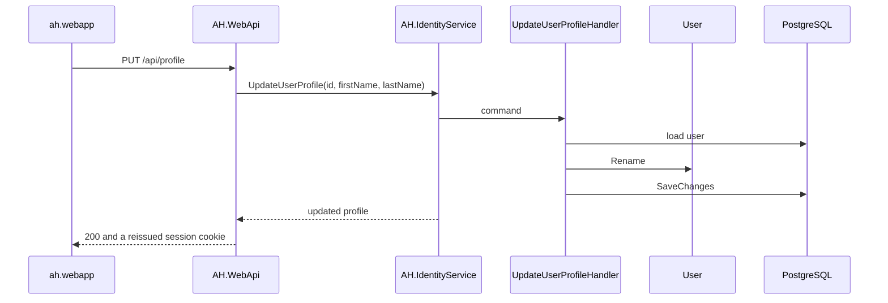
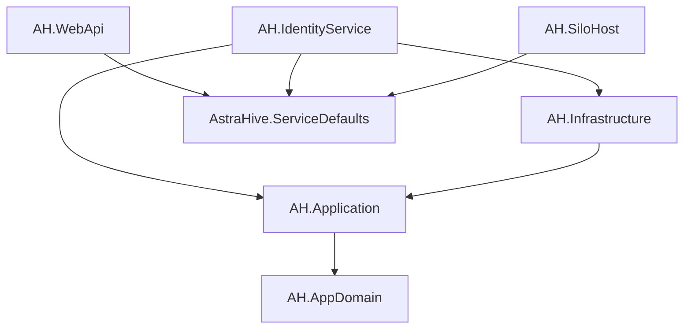
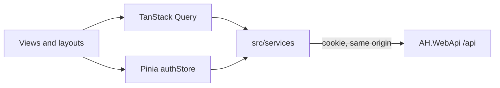
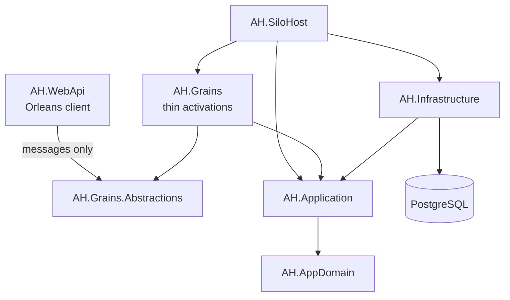

# Architecture

Astra Hive is a virtual machine orchestration system: operators connect to virtual machines over SSH, group them into clusters, and schedule recurring maintenance tasks. That orchestration is the target shape of the system. What runs today is the console and identity: a Vue application served by `AH.WebApi`, external sign-in, and a gRPC service that owns users in PostgreSQL.

.NET Aspire starts the processes and the database. Business rules stay in `AH.AppDomain` and `AH.Application`. Hosts only compose them.

## Runtime

The browser has one origin, `https://localhost:7093`. `AH.WebApi` serves the single-page application, `/api`, and the OAuth callbacks. It never opens the database. User reads and writes go to `AH.IdentityService` over gRPC, and that service is the only process that talks to PostgreSQL and to MinIO object storage. Both hosts read feature flags from an external Unleash server.

`ah-webapp` exists only while `aspire run` is in run mode. The watcher rebuilds the bundle into `AH.WebApi/wwwroot`; refresh the browser to see a change. A Release build of `AH.WebApi` runs `npm run build` itself, so a published host does not need a frontend container. `AH.SiloHost` is started, but it is still the stock template: no Orleans silo, no database, and nothing calls it.

PostgreSQL is the Aspire database resource `astrahive`, with a data volume so users survive a restart. `AH.IdentityService` applies EF Core migrations on startup in Development. Production migrations are applied explicitly.

## Sign-in

There are no local passwords and no JWTs. The session is the HttpOnly cookie `astrahive.session` (SameSite=Lax, 14-day sliding expiration). Users sign in with Google, Yandex, or a client certificate (see [Certificate sign-in](#certificate-sign-in)). The Google and Yandex client id and secret come from AppHost parameters, not from source.

On the OAuth callback, `AH.WebApi` calls `GetOrCreateUser` and stores the internal user id in `NameIdentifier`. Every sign-in method goes through `SignInProvisioner`, which applies the same email check first: an email is required and must be a valid address, and Google accounts whose `email_verified` is false are rejected (`email_required`, `email_invalid`, `email_unverified`). Users are matched by email. A provider fills a first or last name only while that field is still empty (`User.SyncFromProvider`). A name the user saved later (`User.Rename`) is kept. The avatar has no editor, so it keeps syncing from the provider.

`GET /api/auth/me` reads the cookie. It does not call IdentityService. `POST /api/auth/logout` clears the cookie. A provider that fails sends the browser to `/login?error=...`.

A user who belongs to no workspace gets one on sign-in while registration is enabled (see [Workspaces](#workspaces)).

### Sign-in rules

Two Unleash flags shape sign-in. Both are off unless enabled on the Unleash server, and read as off when it cannot be reached, so the default deployment is certificate-only and closed. `GetOrCreateUser` (Application) enforces them on every sign-in; WebApi reads them only to tell the login page what to offer (`GET /api/auth/options`) and to skip an OAuth round trip that would be rejected.

| Situation | Result (`/login?error=`) |
| --- | --- |
| Google/Yandex while `ah.external_login` is off | `external_login_disabled` |
| The Global Administrator through Google/Yandex | `certificate_required` (always) |
| Google/Yandex, unverified email | `email_unverified` |
| Unknown email through Google/Yandex, `ah.registration_enabled` off | `registration_disabled` |
| Unknown email through Google/Yandex, registration on | new user with their own workspace |
| Pending (invited) user through Google/Yandex | activated, joins the inviting workspace |
| Certificate not registered to that user, revoked or expired | `certificate_unknown` (a certificate never creates a user) |

`ah.registration_enabled` also gates `POST /api/workspaces` (creating more workspaces).

### Certificate sign-in

A user can also sign in with an X.509 client certificate issued by a trusted root CA. The certificate is an inbound adapter in `AH.WebApi/Auth`, like the OAuth handlers. It ends in the same `SignInProvisioner` and `GetOrCreateUser` call, keyed by the email in the certificate, plus the certificate's SHA-256 thumbprint: IdentityService accepts only certificates registered to that user (`UserCertificate`) and not revoked, which makes revocation work without a CRL.

- Only the login port (7094, the AppHost endpoint `certificate`, not proxied) requests a certificate during the TLS handshake. Kestrel's `OnAuthenticate` turns the request off on every other port, so Google/Yandex users never see a certificate picker. Cookies ignore the port, so the cookie set on :7094 is valid on :7093.
- Trust comes only from `Authentication:Certificate:RootCertificate`, a PEM path or inline PEM holding the public part only. The OS trust store is not used. In development, the Debug build of `AstraHive.AppHost` runs `tools/AH.CertTool dev` once. It creates a root CA in `%LOCALAPPDATA%\AstraHive\dev-certs`, issues the Global Administrator's certificate for `admin@astrahive.local`, and installs it into `CurrentUser\My`. Firefox has its own store: import `<email>.pfx` from that folder (password `astrahive`). To regenerate, delete the folder and rebuild.
- Failures redirect to `/login?error=certificate_required|certificate_invalid|certificate_unavailable|certificate_unknown`.
- In production, run `AH.CertTool init` once (see [Global Administrator](#global-administrator)) and point `AppOrigin` at the public origin. Serving certificate login from a separate host name (e.g. `cert.example.com`) would also need a shared cookie domain; that is not wired yet.

## Global Administrator

Every deployment has one Global Administrator, the first user. It signs in with a client certificate only and owns the main workspace "AstraHive", which holds the operators and never clusters (`Workspace.CanOwnClusters`).

- `tools/AH.CertTool init --out <dir> --email <e> --name <n>` (by hand, once per deployment) writes the root CA (`root.pem`, `root.key.pem`) and the Global Administrator's certificate (`<email>.pfx` with a printed one-time password, `<email>.pem`), and prints the AppHost parameters to fill: `certificate-root`, `certificate-root-key` (secret), `global-admin-email`, `global-admin-name`, `global-admin-certificate`. It refuses to overwrite existing files. In run mode the AppHost uses the dev files from `AH.CertTool dev` instead.
- On every start IdentityService runs `EnsureGlobalAdministrator` (config `GlobalAdmin:*`): it creates or promotes the user, creates the main workspace and registers the bootstrap certificate, whichever is missing. A different email than the stored Global Administrator is logged and ignored.
- In the main workspace nobody can demote or remove the Global Administrator (`Workspace.IsProtectedMember`, 403).

### Issuing certificates

Only the Global Administrator issues certificates, for members of the main workspace. IdentityService holds the root key (`CertificateAuthority:{Certificate, PrivateKey}`); WebApi never sees it.

`DELETE .../certificates/{certId}` revokes: sign-in with it fails from then on and the PFX is deleted. The Global Administrator's last active certificate cannot be revoked (409).

## Profile

The profile page loads the user from the database, not from the cookie, so the screen shows the stored record.

`AH.WebApi` reissues `astrahive.session` after a successful rename because `/api/auth/me` serves the name from claims. If the cookie names a user the database no longer has, the API signs the session out and returns 401, and the console returns to the login page.

## Workspaces

A workspace is the tenant: it will own clusters, and its members share them. Each member has one role per workspace: **Administrator** (manages members) or **Viewer** (read-only). A user can belong to several workspaces; the console has a workspace switcher, and the selection is remembered in the browser.

- **First sign-in:** while `ah.registration_enabled` is on, `GetOrCreateUser` gives a user who belongs to no workspace a new one (`"<first name>'s workspace"`) with that user as Administrator, in the same save. With registration off, such a user signs in to an empty console.
- **Main workspace:** see [Global Administrator](#global-administrator).
- **Adding members:** an Administrator adds people by email. An email that never signed in becomes a *pending* user (`User.CreatePending`, `LastLoginAt` null). Their first sign-in with that email, through any provider, matches the pending user, so they land in that workspace and get no workspace of their own.
- **Invariant:** a workspace keeps at least one Administrator (`Workspace.IsLastAdministrator`). Demoting or removing the last one returns 409.
- **Authorization:** the session cookie carries only the user id. Each workspace call sends it as `requester_id` to IdentityService (`WorkspaceServiceRpc`, `Protos/workspace_service.proto`), whose handlers load the membership from PostgreSQL. A role change or removal applies on the next request. Non-members get 404, so they cannot probe workspace ids; Viewers get 403 on changes.

| Endpoint | Who |
| --- | --- |
| `GET /api/workspaces` | the caller's workspaces with their role (main workspace first) |
| `POST /api/workspaces` `{ name }` | any user, while `ah.registration_enabled` is on |
| `GET /api/workspaces/{id}/members` | any member |
| `POST /api/workspaces/{id}/members` `{ email, role }` | Administrator |
| `PUT /api/workspaces/{id}/members/{userId}` `{ role }` | Administrator |
| `DELETE /api/workspaces/{id}/members/{userId}` | Administrator (also to leave, while another Administrator remains) |
| `GET`/`POST /api/workspaces/{id}/members/{userId}/certificates` | Global Administrator, main workspace |
| `GET .../certificates/{certId}/download`, `DELETE .../certificates/{certId}` | Global Administrator, main workspace |

Roles travel as the strings `"Administrator"` and `"Viewer"`.

## Errors

Expected failures travel as `Result<T>` from the handler, become gRPC status codes in `RpcResults` (IdentityService), and become Problem Details (RFC 9457) in the API (`RpcProblems`): validation 400, forbidden 403, not found 404, conflict 409. Exceptions are for unexpected failures.

## Layers

Dependencies point inward. `AH.AppDomain` references nothing. `AH.Application` references only the domain (plus EF Core abstractions, so `IAppDbContext` can expose `DbSet<T>`). `AH.Infrastructure` implements those interfaces. Orleans types stay out of the domain and the application layer.

`AH.WebApi` does not reference `AH.Application` or `AH.Infrastructure`. Its only view of users and workspaces is the linked protobufs `AH.IdentityService/Protos/user_service.proto` and `workspace_service.proto`, compiled as gRPC clients. `GrpcChannel` cannot use Aspire's `https+http://` scheme, so the client address is `http://ah-identityservice`; service discovery still resolves the host.

A use case is a folder under `AH.Application`: a command or query, a plain handler class, a FluentValidation validator, and a response DTO. Handlers are registered in `AddApplication()` and injected where they are used. There is no mediator and no repository per entity. `IAppDbContext` is the data-access surface.

`User` is the only aggregate so far. It enforces email normalization, name length, and the rule that a later provider sign-in does not overwrite a stored name.

## Frontend

`ah.webapp` is Vue 3 (`<script setup>`, JavaScript), Vue Router, Pinia, vue-i18n, and Tailwind. Server data goes through TanStack Query composables and `src/services`. Pinia holds the session (`authStore`) and nothing else that belongs in the database.

`App.vue` chooses the signed-out or signed-in layout from `authStore.isAuthenticated`. The router waits for one `GET /api/auth/me` probe before it renders a protected route. Unknown `/api/*` paths return 404 instead of `index.html`.

## Orchestration, not built yet

Virtual machines, clusters, and scheduled tasks are meant to be Orleans grains: one single-threaded activation per entity, with the rules still living in the domain and in application handlers. Grain projects exist and are empty. `AH.SiloHost` does not host a silo, and `AH.WebApi` is not a client.

When this is built, a grain opens a scope per call and resolves the handler from it. A grain activation outlives a request, so it must not take a scoped `IAppDbContext` or handler in its constructor. Domain rows stay in PostgreSQL. Orleans storage is for transient grain state, not for the registry of machines. Development clustering is localhost with in-memory grain storage. Production clustering is not chosen.

`AH.WebApi` would reference `AH.Grains.Abstractions` only. It would not reference `AH.Grains`.

## Projects

| Project | Role today |
| --- | --- |
| `ah.webapp/` | Vue console. Built into `AH.WebApi/wwwroot`. |
| `AH.WebApi/` | Browser host: static files, cookie session, OAuth, controllers. gRPC client of IdentityService. |
| `AH.IdentityService/` | gRPC `UserServiceRpc` and `WorkspaceServiceRpc`. Composition root for users and workspaces. Applies migrations in Development. |
| `AH.AppDomain/` | `User`, `Workspace` (members, roles) and their invariants. No NuGet dependencies. |
| `AH.Application/` | `GetOrCreateUser`, `GetUser`, `UpdateUserProfile`; workspace queries and member commands. |
| `AH.Infrastructure/` | `AppDbContext`, EF configurations, migrations. |
| `AH.Grains.Abstractions/` | Empty. Future grain interfaces and serializable messages. |
| `AH.Grains/` | Empty. Future thin grain implementations. |
| `AH.SiloHost/` | Empty host with health endpoints. Future Orleans silo. |
| `AstraHive.AppHost/` | Aspire: Postgres, the three hosts, and the frontend watcher in run mode. |
| `AstraHive.ServiceDefaults/` | OpenTelemetry, health checks, service discovery, HTTP resilience, Serilog. |
| `tests/AH.Application.Tests/` | Domain and handler tests against PostgreSQL in Testcontainers. |

Projects sit at the repository root. `/src/` and `/tests/` in `AstraHive.slnx` are solution folders only.

## Cross-cutting

Each host calls `AddServiceDefaults()`. Logs use Serilog in the host, with `ILogger<T>` everywhere else, and flow to the Aspire dashboard through OpenTelemetry. HTTP clients take the ServiceDefaults resilience pipeline. Service URLs and the database connection come from Aspire references.

Coding conventions for contributors are in [`AGENTS.md`](AGENTS.md).
